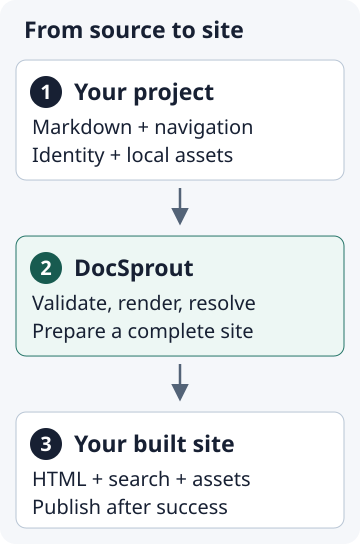

# Architecture

DocSprout is a command-line application that turns project-owned Markdown and
navigation into static files. A consuming project owns its content and visual
identity; the installed package supplies the renderer, CSS and browser code.

## Follow one build

The three stages are **project-owned inputs**, **DocSprout's build**, and
**a complete static site**. The image is a local SVG; the steps below provide
the same information in text and name the modules to explore.

1. `cli.py` chooses a command and project root. `check` calls the same builder
   as `build`, but writes into a temporary directory.
2. `config.py` loads `docsprout.json` and the navigation layout, validates
   paths and fields, and returns a `SiteConfig`. `layout_markdown.py` parses
   `layout.md` into the same navigation shape as `layout.json`.
3. `palette.py` derives colours and checks contrast against the reading
   surfaces. `build.py` assigns routes and rejects route collisions.
4. `markdown.py` renders the supported Markdown subset and assigns heading
   IDs. `build.py` resolves links against published pages, validates heading
   fragments and copies linked local assets.
5. `build.py` writes each page in the shared HTML shell, then writes the search
   index and release metadata. `assets.py` supplies the site CSS and JavaScript;
   the package also carries local KaTeX assets.
6. `safety.py` replaces the owned output directory only after the single-site
   build succeeds. A failed render leaves the previous site available. Staging
   beside the destination keeps directory renames on the same filesystem.

`serve` rebuilds that same site when source files change. `audit.py` adds
publication diagnostics, including warnings about image descriptions and
heading structure. `versions.py` checks immutable release references and
builds historical releases from isolated Git archives. `safety.py` limits
replacement of existing output to DocSprout-owned directories.

For a first code change, start with the command in `cli.py`, follow its call
into the owning module above, and read the corresponding tests listed in the
repository's `CONTRIBUTING.md` code map. Run the focused test while editing,
then the full suite. Changes to routes, configuration, generated formats or
command behavior also need a review of the contract below.

## Keep rendering contexts separate

The inline renderer treats prose, image descriptions and URL destinations as
different contexts. Code and math become elements in prose, plain text in an
image's alternative description, and exact source characters in a URL.
Completed elements are protected from later formatting passes. This prevents
emphasis from changing a destination and keeps generated markup out of HTML
attributes.

When extending Markdown, start with `tests/test_inline_contexts.py` and
`tests/test_markdown.py`. Exercise the new syntax inside a link label, an image
description, code and math, as well as ordinary prose. Parse the resulting HTML
to check element and attribute boundaries; a string containing `&quot;` alone
does not prove that the final element is safe.

## Compatibility surface

The public compatibility contract consists of:

- documented configuration files and their schema-version-1 fields
  (`docsprout.json`, `layout.json`, `versions.json`);
- the pre-rebrand `docs/dockit.json` filename, the deprecated `dockit-fp`
  console script and the `python -m dockit_fp` module entry point;
- CLI commands, options and exit-code semantics;
- generated routes (see [Machine-readable contracts](machine-contracts.md));
- machine formats: `search-index.json`, `release.json`, built-site
  `versions.json` and `audit --format json`;
- the documented `--dk-*` public token family;
- the custom CSS inclusion mechanism (`theme.custom_css`);
- reusable-workflow inputs.

Internal selectors, DOM wrappers, exact generated whitespace, private Python
modules and human CLI prose are deliberately not part of the contract; see
the boundary in [Machine-readable contracts](machine-contracts.md).

## Compatibility policy

v1.x prefers compatible additions. Deprecations remain available for at least
one minor release and are documented before a future major removal; schema and
machine-format changes require a new schema version and migration guidance.

## The Python API boundary

DocSprout is primarily a CLI/application package. `docsprout.__version__` is
public and may be used for version inspection. All other modules, classes and
functions are implementation details unless explicitly documented as public;
downstream tools should use the CLI and the machine formats.

## Language of this release

v1.0.0 is the stable commitment point for the **minimal CLI + obvious
declarative configuration** model: `layout.json` is the authoritative
navigation model (pages, sections, titles, order, home, publication),
`docsprout.json` describes appearance and identity, and no authoring-mutator
commands exist. v1.1.0 renews the same model under the DocSprout name; the
pre-rebrand aliases are deprecated and are removed in v2.0.0. The default site
needs no custom CSS; the custom stylesheet mechanism is a deliberately bounded
escape hatch whose inclusion mechanics DocSprout owns and whose accessibility
the author owns.

Downstream projects should pin released tags such as `v1.3.2`, never the main
branch. The stable boundary and deprecation policy are in [Machine-readable
contracts](machine-contracts.md).
